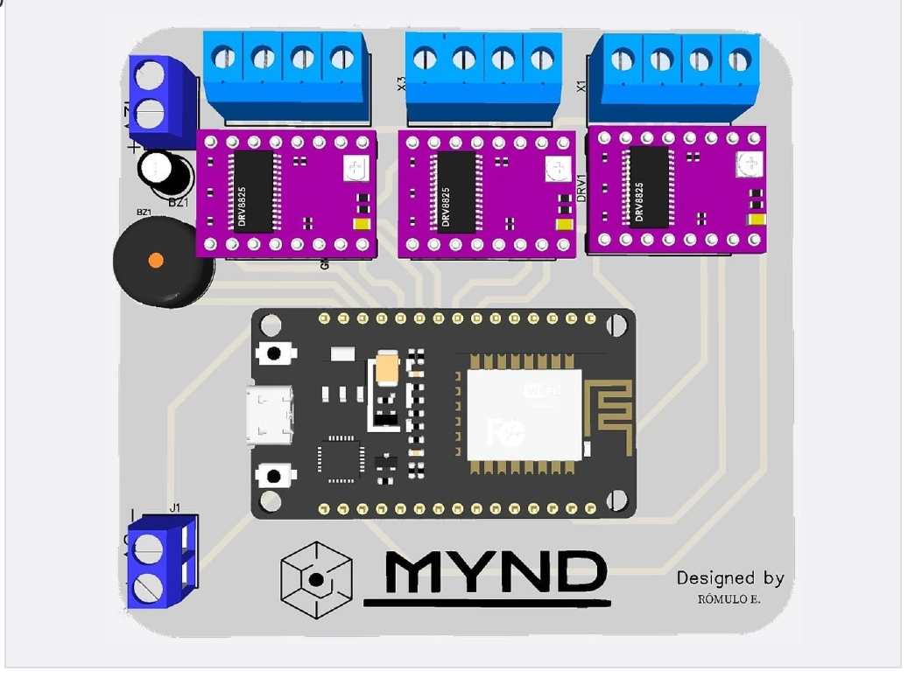
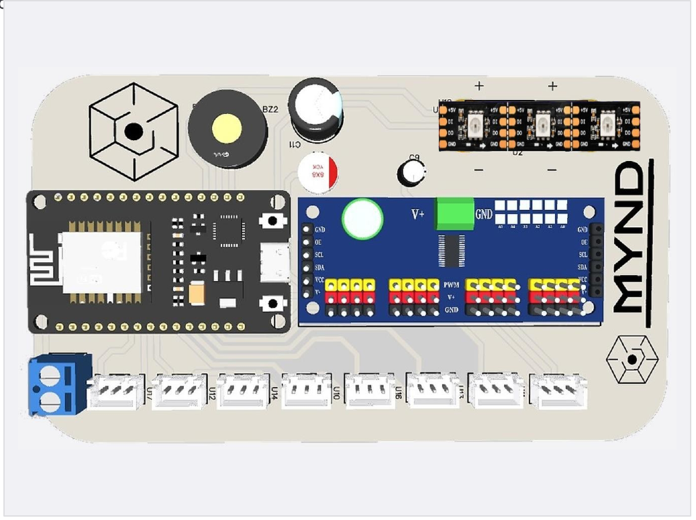
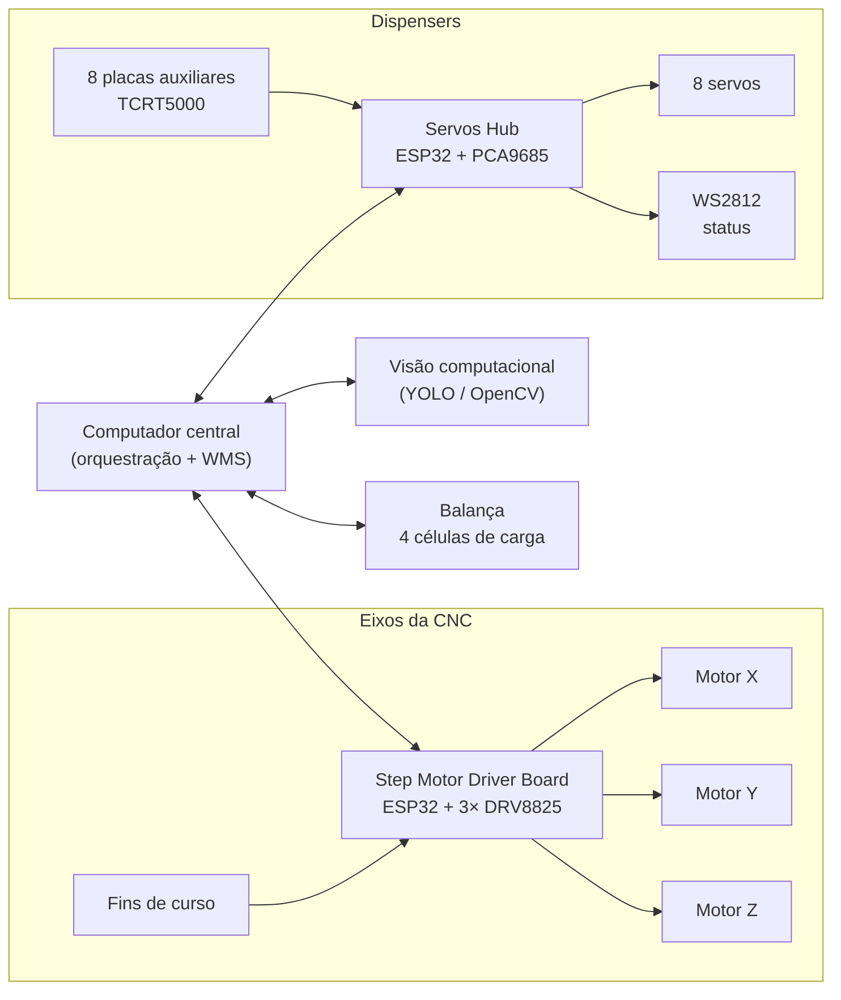
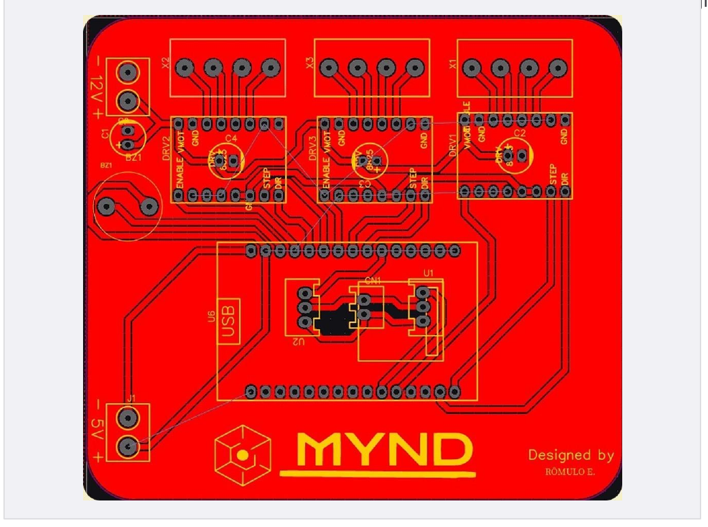
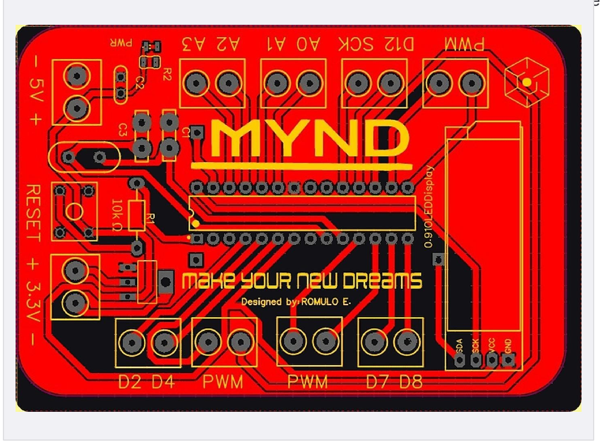
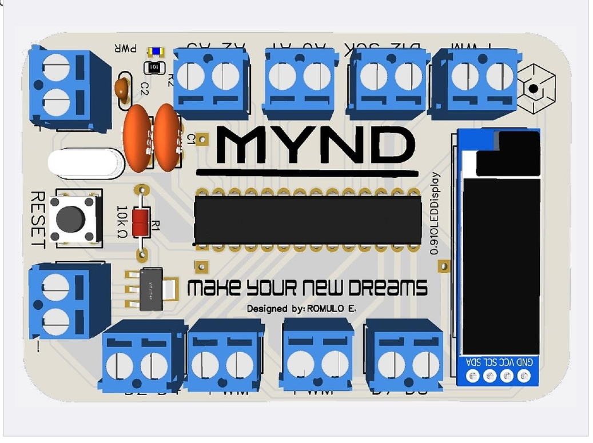
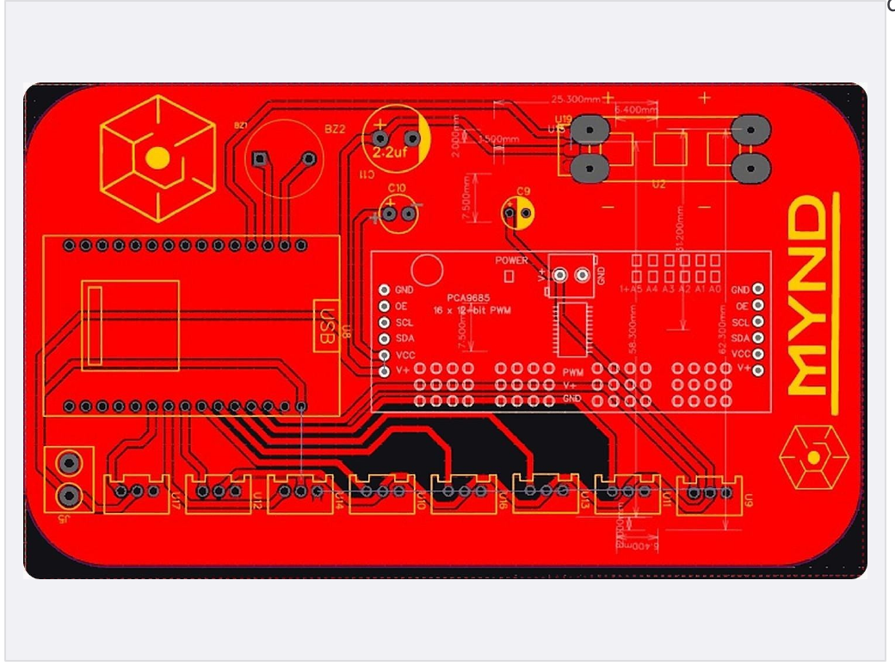
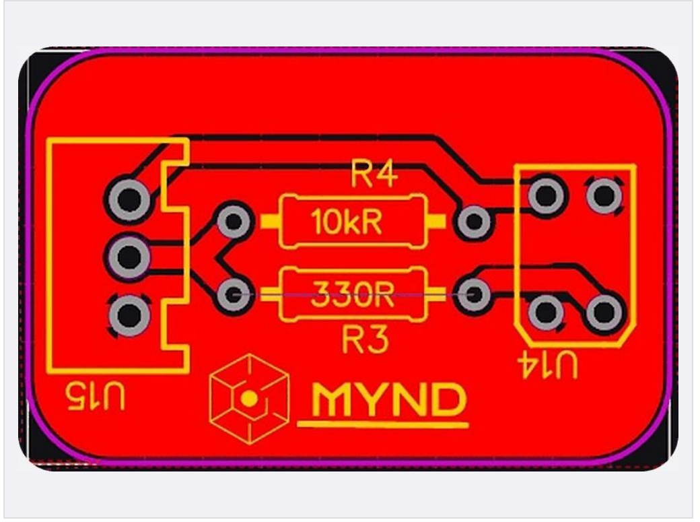
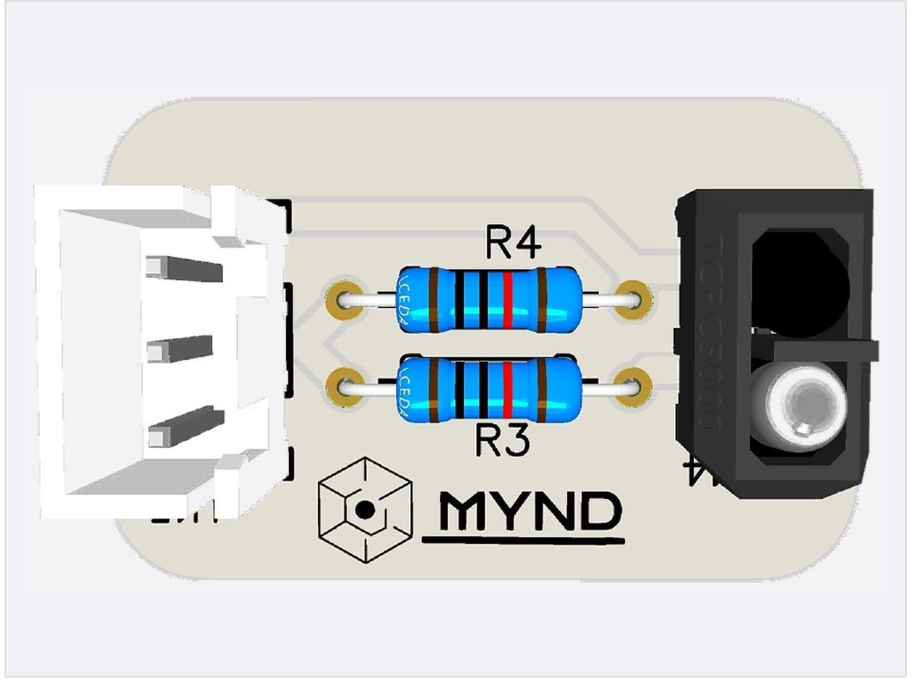

<div align="center">

# Valory Electronics

**Hardware embarcado da VALORY: célula robótica de cartonização de medicamentos**
1º lugar no FIAP NEXT 2026, no Challenge Pharma Robotics proposto pela **Apsen Farmacêutica** em parceria com a **Softtek**


 

</div>

---

## Visão geral

A VALORY é uma célula automatizada construída sobre uma **CNC cartesiana com 8 dispensers independentes**. Ela separa e deposita medicamentos com **redundância tripla de validação**: ciclo da CNC, peso (4 células de carga) e visão computacional.

Este repositório reúne **toda a eletrônica projetada pela equipe**: 3 esquemáticos, 4 PCBs próprias, topologia de interligação e montagem física. Tudo foi desenhado no EasyEDA, com identidade visual da [MYND](#créditos), e fabricado para a bancada do Challenge.

| # | Placa | Função na máquina | MCU | Destaques |
|---|---|---|---|---|
| 1 | **Step Motor Driver Board** | Aciona os 3 eixos da CNC | ESP32 DevKit V1 | 3× DRV8825, 12 V de potência, buzzer, 2 entradas de fim de curso |
| 2 | **ATmega328P Minimum Circuit** | Placa de E/S de uso geral com telinha de pinout | ATmega328P-PU | Cristal de 16 MHz, AMS1117-3.3, OLED 0,91" I²C |
| 3 | **Servos Hub: MainBoard** | Comanda os 8 dispensers e lê os 8 sensores | ESP32 DevKit V1 | PCA9685 (16 canais, 12 bits), 8 servos, LEDs WS2812 de status |
| 4 | **Placa Auxiliar: Sensor** | Confirma a saída de cada medicamento | n/a | TCRT5000 refletivo, 28 × 18 mm |

---

## Arquitetura



Cada dispenser tem um servo (liberação) e uma placa auxiliar com TCRT5000 (confirmação). Se o sensor não vê o medicamento passar, o Servos Hub reporta erro. A divergência entre CNC, balança e visão bloqueia a operação.

---

## 1. Step Motor Driver Board

Placa de acionamento dos motores de passo, com controladora ESP32 e três estágios DRV8825.

 

| Item | Especificação |
|---|---|
| Controladora | ESP32 DevKit V1 (30 pinos) |
| Estágios de potência | 3 × DRV8825, com capacitor de desacoplamento em VMOT |
| Alimentação | 5 V lógica (borne J4) · 12 V potência (borne J) |
| Saídas | 3 bornes de 4 vias (A1/A2/B1/B2) para os motores |
| Extras | Buzzer em D13 · 2 conectores de 3 vias para fim de curso (D19 e D32) |
| Micropasso | M0–M2 sem ligação, passo completo |

**Mapa de pinos ESP32 → drivers**

| Driver | DIR | STEP | EN |
|---|---|---|---|
| DRV1 (X1) | GPIO22 | GPIO23 | GPIO21 |
| DRV2 (X2) | GPIO14 | GPIO27 | GPIO12 |
| DRV3 (X3) | GPIO33 | GPIO25 | GPIO26 |

`SLEEP` e `RESET` de cada driver estão presos em VCC; o `EN` é controlado por software para desenergizar os motores em repouso.

[Esquemático completo (folha 1/3)](img/schematic-1-step-motor-driver.png)

---

## 2. ATmega328P Minimum Circuit

Placa mínima do microcontrolador, com regulação de 3,3 V, display OLED e barramento de E/S em bornes.

 

| Item | Especificação |
|---|---|
| Microcontrolador | ATmega328P-PU, cristal de 16 MHz com capacitores de 22 pF |
| Regulação | AMS1117-3.3 |
| Interface | OLED 0,91" I²C (SDA/SCL) · botão de reset · LED de power |
| E/S | Bornes para GPIO, entradas analógicas (A0–A3) e PWM |

[Esquemático completo (folha 2/3)](img/schematic-2-atmega328p.png)

---

## 3. Servos Hub: MainBoard

Placa concentradora dos servos, com expansor PWM de 16 canais e oito saídas de conector.

 

| Item | Especificação |
|---|---|
| Controladora | ESP32 DevKit V1 (30 pinos) |
| Expansor PWM | PCA9685, 16 canais, 12 bits, via I²C |
| Saídas | 8 conectores de servo |
| Entradas | 8 sensores IR (TCRT5000) |
| Sinalização | LEDs endereçáveis WS2812 (call back do sistema) · buzzer |
| Dimensões | 126,365 × 73,533 mm |

**Pinagem usada no firmware**

| Função | GPIO |
|---|---|
| PCA9685 SDA / SCL | 22 / 23 |
| WS2812 (data) | 2 |
| Buzzer | 15 |
| IR-1 … IR-8 | 13, 12, 14, 27, 26, 25, 33, 32 |

Na inicialização, a placa faz uma varredura (cada servo de 0° a 90° em passos de 10°) com sinal sonoro e luminoso. Depois, conta e reporta cada mudança de estado dos sensores IR. A calibração dos servos fica salva na memória `Preferences` do ESP32.

[Esquemático completo (folha 3/3)](img/schematic-3-servos-hub.png)

---

## 4. Placa Auxiliar: Sensor

Placa de entrada com sensor óptico refletivo e resistores de polarização, uma por dispenser.

 

| Item | Especificação |
|---|---|
| Sensor | Óptico refletivo TCRT5000 |
| Resistores | R3 330 Ω (LED IR) · R4 10 kΩ (pull-up do fototransistor) |
| Conexão | Conector de 3 vias (VCC, GND, sinal) até o Servos Hub |
| Dimensões | 28,000 × 18,000 mm |

---

## Estrutura do repositório

```
Valory-Electronics/
├── README.md
├── docs/
│   └── Documentacao_Eletronica_Valory_CHALLENGE2K26.pptx   # documentação completa (8 folhas)
└── img/
    ├── schematic-1-step-motor-driver.png
    ├── schematic-2-atmega328p.png
    ├── schematic-3-servos-hub.png
    ├── *-pcb.png    # roteamento, vista superior
    └── *-3d.png     # vista 3D da placa montada
```

> Para quem quiser fabricar: exporte os Gerbers direto do projeto no EasyEDA. Os arquivos-fonte podem ser adicionados em `hardware/` (`.json` do EasyEDA, Gerbers e BOM).

---

## Projetos relacionados

- [Apsen-vision-system](https://github.com/RomuloEXavier2/Apsen-vision-system): contagem de caixas com YOLOv11, a terceira camada de validação
- [Apsen-App](https://github.com/RomuloEXavier2/Apsen-App): aplicação de gestão logística (WMS) da célula

## Créditos

**Equipe Valory:** Rômulo Estevam Xavier, Gustavo Paraszczuk de Azevedo Marques, Jennifer de Souza, Fernando Bertolucci, João Antonio Domingues Gonçalves e Leonardo Ken Stefano.

**Instituição:** FIAP · **Desafio:** Apsen Farmacêutica + Softtek · **Hardware designed by** Rômulo E. · Powered by **MYND (Make Your New Dreams)**


